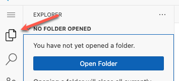
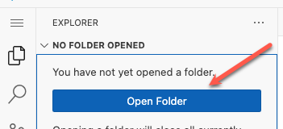
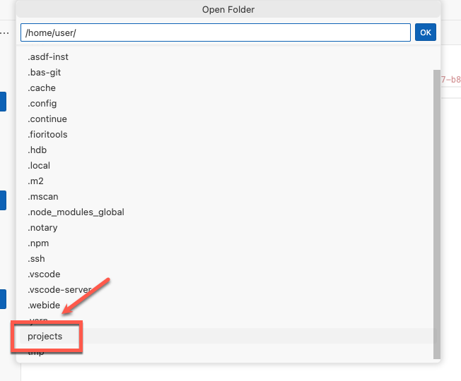
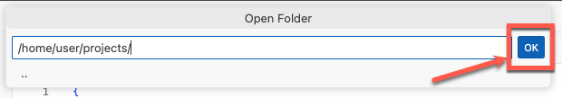
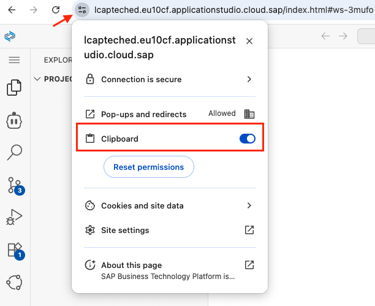

# Getting Started - Set up your AI Development Environment

In this exercise you will set up SAP Business Application Studio (SBAS) as your development environment and configure GitHub Copilot as your AI assistant.

## Onboard SAP Business Application Studio

If you don't have access to SAP Business Application Studio yet, follow the official tutorial to onboard it in your SAP BTP Trial account:

👉 [Set Up SAP Business Application Studio for Development](https://developers.sap.com/tutorials/appstudio-onboarding)

This tutorial walks you through:

- Logging into SAP BTP Trial
- Enabling Cloud Foundry
- Checking the required entitlements
- Launching SAP Business Application Studio for the first time

> [!TIP]
> Bookmark the SAP Business Application Studio dev space manager page once you reach it — you will come back to it in every exercise.

## Create a Dev Space for SAP Fiori Apps

Next, create a preconfigured dev space tailored for SAP Fiori development by following this tutorial:

👉 [Create a Dev Space for SAP Fiori Apps](https://developers.sap.com/tutorials/appstudio-devspace-fiori-create)

Follow the tutorial end-to-end to:

1. Open the SAP Business Application Studio dev space manager.
2. Click **Create Dev Space**.
3. Enter a dev space **name** (for example `AgenticAppDevelopment`).
4. Choose **SAP Fiori** as the application type.
5. Click **Create Dev Space** and wait until the dev space status is **RUNNING**.
6. Click the dev space name to open it, and accept any legal/privacy prompts.

> [!NOTE]
> After a period of idle time the dev space is automatically stopped. To restart it, open the dev space manager, click the **Play** icon next to your dev space, and then click the dev space name to open it.

## Open your project folder

1. Select the **explorer icon** on the left side.

    

2. Select **Open Folder**.

    

3. Select the **projects** folder from the drop down.

    

4. Click **OK** and your window will reload.

    

5. Enable **Clipboard access** for the SBAS instance in the Chrome browser.

    

6. Unzip [`Images.zip`](../../Images.zip) into your workspace so the sample images are available for the upcoming exercises.

    1. Download [`Images.zip`](../../Images.zip) to your local machine.
    2. Drag and drop Images.zip in to projects in the SBAS explorer.
    3. Open a terminal in SBAS. then run:

        ```bash
        unzip Images.zip.
        ```

    4. Confirm that an `Images` folder (with the screenshots) now appears in the explorer.


## Install Skills for CAP and SAP Fiori Application Development

To enhance AI assistance with CAP and SAP Fiori development patterns and best practices, install the corresponding skills into your project:

1. Open the integrated terminal in SBAS.

2. Install the **CAP** development skills:

    ```bash
    npx skills add https://github.com/capire/skills.git
    ```

    Follow the interactive prompts and choose **Project** as the installation scope.

3. Install the **SAP Fiori** development skills:

    ```bash
    npx -y skills add https://github.com/SAP/open-ux-tools/tree/main/plugins-coding-agents/fiori/skills --skill '*'
    ```

    Follow the interactive prompts and choose **Project** as the installation scope.

> [!NOTE]
> Installing skills at **Project** scope keeps them scoped to this workspace, so AI Chat can pick up CAP and SAP Fiori guidance automatically whenever you work in this project.

4. Ensure that the Projects folder has following content

     // change image


## Summary

You have successfully set up your AI development environment with SAP Business Application Studio, configured GitHub Copilot, and installed the CAP and SAP Fiori development skills.

Continue to - [Exercise 1.0 - Create CAP Project and Fiori List Report App based on Image](../ex1.0/README.md)

