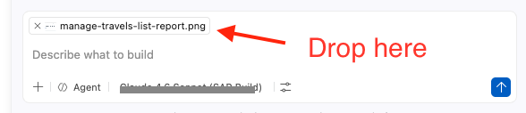
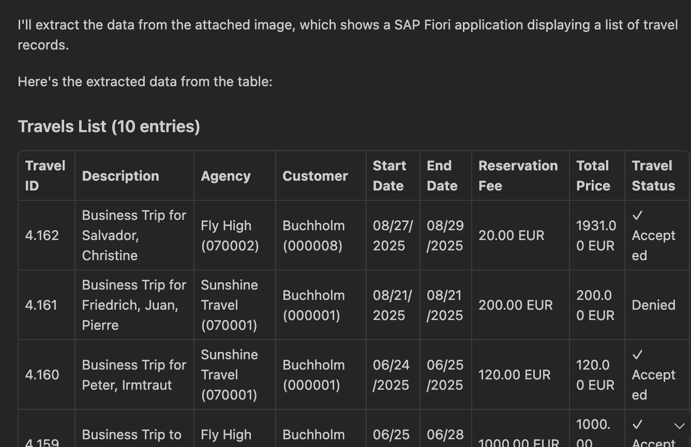
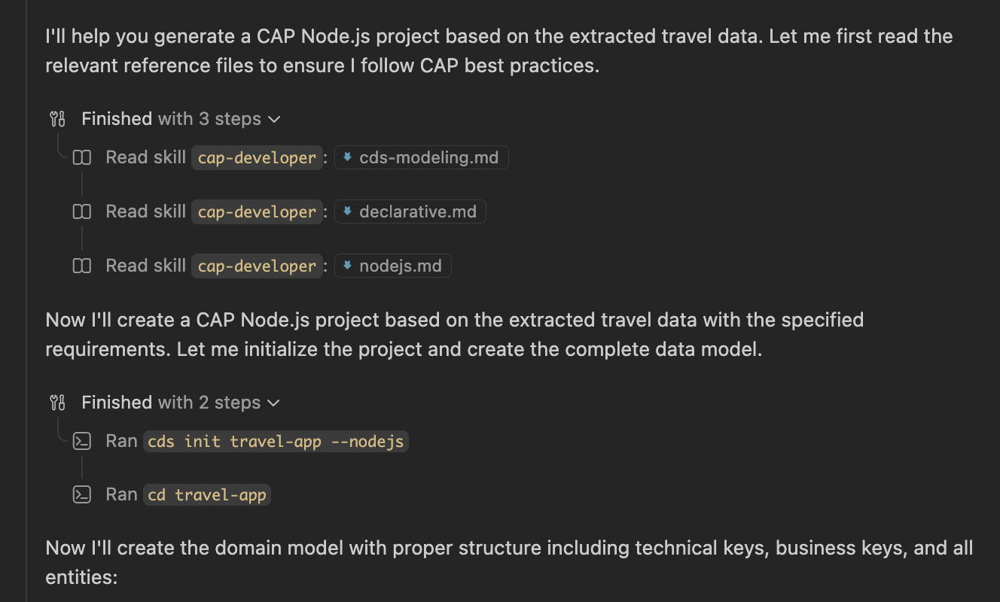
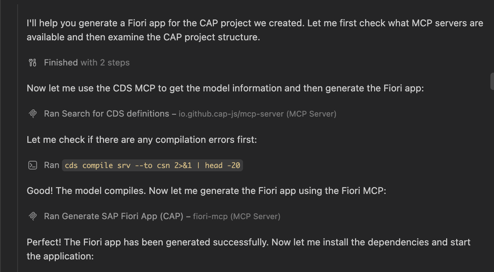
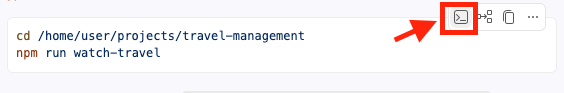
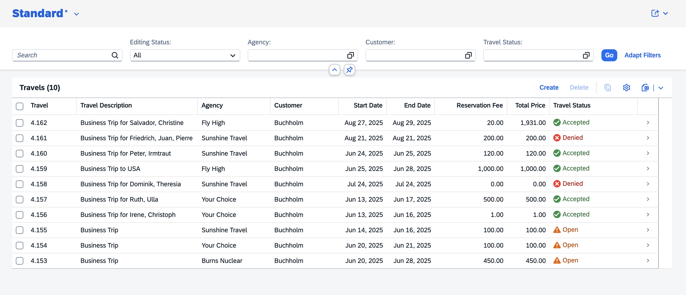
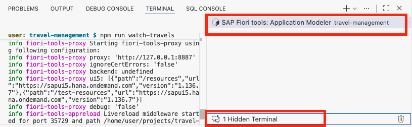
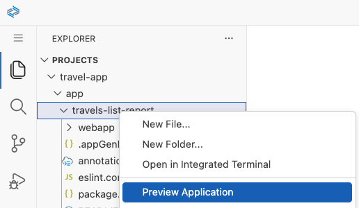
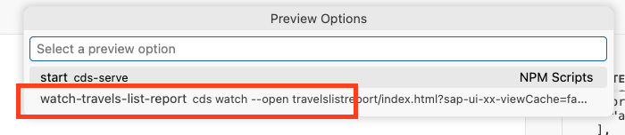
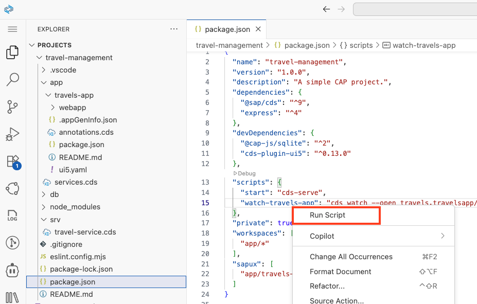

# Create CAP Project and Fiori List Report App based on Image

1. Drag and drop the image [manage-travels-list-report.png](../../manage-travels-list-report.png) from the Images folder into the Copilot Chat window to attach it as context.

    


2. Copy and paste the following prompt into the task input and execute the task:

    ```
    Extract data from the attached Image. Do not inspect any other image files in the workspace.
    ```
3. Verify that the extracted data matches the image.

    

4. Copy and paste the following prompt into the task input and execute the task:

    ```
    /cap-developer Generate a new CAP Node.js project based on the extracted data.
    - Include both a technical key and a business key for every entity.
    - Use USD as the currency throughout the application.
    - Apply criticality to the travel status.
    - Track your work with a to-do list.
    ```

5. Copilot generates the CAP project by applying the guidelines defined in the `cap-developer` skill.

    

6. Click **Allow** when prompted to run Bash commands.

7. Review the files and content created by Copilot, then click **Keep** to accept them.

8. Confirm that the CAP project has been successfully created in your workspace.

9. Copy and paste the following prompt into the task input and execute the task:

    ```
    /sap-fiori-app-development Generate SAP Fiori app based on cap project and 
    - SAP Fiori app should match extracted data from the image(table colums, filters etc)
    - Use UI5 version 1.148.12
    - Use USD as currency throughout the application 
    - Consult available MCP servers.
    ```

10. Copilot generates the SAP Fiori app by applying the guidelines defined in the sap-fiori-app-development skill.
    

11. To run the application, click the **Insert into Terminal** button when Copilot presents the watch command.

    

    The application will open in your browser, displaying a travel list report application that matches similar to the uploaded screenshot.

    

## Troubleshoot

1. Application preview does not open automatically in the browser:

    - Stop any running processes using `Ctrl+C`, then delete all terminal windows, including any hidden ones.

        

    **Option 1:**
    
    - Right-click on the Fiori app and select the watch script. **Important:** Keep the application preview terminal running—do not close it.

        

        

    **Option 2:**
    
    - You can start the watch script manually:
        - Open the **package.json** file.
        - Right-click on the **watch** script and select **Run Script**.

        

2. If HTTP port 4004 is already in use, press `Enter` to restart preview with a different port number.

> [!NOTE]
> Ensure that you either use 4004 or the system-assigned port for the preview. Check terminal instances and delete any duplicate processes running to preview the application.

3. If the application prompts for authentication, use username: `dummy` and password: `dummy`.

## Summary

You have successfully created a CAP project with a Fiori List Report application based on the Image.

Continue to - [Exercise 1.1 - Enable automatic data loading in List Report](../ex1.1/README.md)
